# Анализ Backend и WebSearch системы QnA Evaluator

## Диаграмма потока данных

```mermaid
graph TB
    subgraph Frontend
        F1[React Frontend] --> F2[POST /api/simple-evaluate.mjs]
        F2 --> F3["Request Body:<br/>questionId + allAnswers"]
    end
    
    subgraph "Backend Entry Point"
        F3 --> B1[py_local_api_server.py]
        B1 --> B2[Load app.config.json]
        B1 --> B3[evaluate_answer_logic]
    end
    
    subgraph "Context Building"
        B3 --> C1[Load questions from q4.json]
        B3 --> C2[Load AI prompt from ai-prompt.txt]
        B3 --> C3[Build payload context]
        C3 --> C4["Include:<br/>- question text<br/>- readable answer<br/>- meta answers<br/>- dependent answers"]
    end
    
    subgraph "WebSearch Decision"
        C4 --> W1{WebSearch Decision}
        W1 --> W2[Check force_search_all]
        W2 -->|true| W3[Always Search]
        W2 -->|false| W4[Check triggers & patterns]
        
        W4 --> W5{Business Filter}
        W5 -->|disabled| W3
        W5 -->|enabled| W6[Skip if business evaluation]
        
        W3 --> W7[Extract search query]
        W7 --> W8[Clean query from triggers]
    end
    
    subgraph "Search Router"
        W8 --> S1[SearchRouter]
        S1 --> S2[QueryClassifier]
        S2 --> S3["Classify query type:<br/>- factual<br/>- current<br/>- general"]
        
        S3 --> S4[Select providers by type]
        S4 --> S5{Strategy}
        S5 -->|smart_routing| S6[Use suggested providers]
        S5 -->|all_providers| S7[Use all providers]
    end
    
    subgraph "Search Execution"
        S6 --> E1[Execute parallel search]
        S7 --> E1
        
        E1 --> P1[DuckDuckGo Provider]
        E1 --> P2[Wikipedia Provider]  
        E1 --> P3[RSS Provider]
        
        P1 --> P4[LangChain DuckDuckGoSearchAPIWrapper]
        P2 --> P5[Wikipedia API]
        P3 --> P6[RSS Feed Parser]
    end
    
    subgraph "Result Processing"
        P4 --> R1[Convert to SearchResult]
        P5 --> R1
        P6 --> R1
        
        R1 --> R2[Aggregate results]
        R2 --> R3[Remove duplicates by URL]
        R3 --> R4[Rank by score + bonuses]
        R4 --> R5[Limit to max_results]
        
        R5 --> R6[Format as markdown/text]
    end
    
    subgraph "AI Integration"
        R6 --> A1[Insert as system message]
        A1 --> A2[AI Provider<br/>OpenAI/Ollama]
        C4 --> A2
        
        A2 --> A3[Parse response]
        A3 --> A4["Extract:<br/>- score (0-100)<br/>- explanation"]
    end
    
    subgraph "Response"
        A4 --> RES1[JSON Response]
        RES1 --> RES2[Return to Frontend]
    end
    
    style W3 fill:#90EE90
    style W6 fill:#FFB6C1
    style S1 fill:#87CEEB
    style A2 fill:#DDA0DD
```



## Детальный анализ процесса

### 1. Точка входа (Entry Point)

**Путь данных от Frontend:**
1. Frontend отправляет POST запрос на `/api/simple-evaluate.mjs`
2. Тело запроса содержит:
   - `questionId` - ID вопроса из q4.json
   - `allAnswers` - объект со всеми ответами пользователя

**Обработка в py_local_api_server.py:**
```python
@app.route('/api/simple-evaluate.mjs', methods=['POST'])
def handle_simple_evaluate():
    data = request.get_json()
    question_id = data['questionId']
    all_answers = data['allAnswers']
    config = load_app_config()  # Загружает app.config.json
    
    result = evaluate_answer_logic(
        question_id, 
        all_answers, 
        config, 
        question_file, 
        prompt_file
    )
```

### 2. Сборка контекста для AI

**py_simple_evaluate.py** выполняет следующие шаги:

1. **Загрузка данных:**
   - Вопросы из `public/questions/q4.json`
   - AI промпт из `public/questions/ai-prompt.txt`

2. **Построение контекста (payload):**
   ```python
   payload = {
       'system': _ai_prompt,  # Базовый промпт
       'additional_context': question.get('prompt_add', ''),  # Доп. инструкции
       'meta': {},  # Мета-информация (локация и т.д.)
       'question': {'id': question['id'], 'text': question['text']},
       'answer': get_readable_answer(...),  # Читаемый ответ
       'answers_ctx': {}  # Зависимые ответы
   }
   ```

3. **Обработка зависимостей:**
   - `ai_context.include_meta` - добавляет мета-данные
   - `ai_context.include_answers` - добавляет ответы на связанные вопросы

### 3. Механизм принятия решения о WebSearch

**Ключевая проблема: WebSearch часто пропускается!**

**ai_providers_with_search.py** проверяет условия:

1. **force_search_all = true** (в конфиге) → **ВСЕГДА выполняет поиск**
2. **force_search_all = false** → проверяет:
   - **Business filters** (если не отключены):
     - Блокирует поиск для business evaluation вопросов
     - Ключевые слова: "business evaluator", "risk assessment", "score from 0-100"
   - **Auto search triggers**:
     - "найди", "поищи", "актуальная информация", "последние новости"
   - **Паттерны текущих событий**:
     - Даты (2024, 2025), "сегодня", "вчера", "недавно"
   - **Фактические вопросы**:
     - "кто", "что", "где", "когда" + текущий контекст

**Проблема в py_simple_evaluate.py:**
```python
# Функция generate_search_query_from_question БЛОКИРУЕТ поиск для:
strategic_question_prefixes = ['SG', 'MET.', 'SGA']  # Все вопросы из q4.json!
business_evaluation_keywords = [
    'selling', 'buyers', 'revenue', 'margin', 'customer', ...
]
```

### 4. Формирование поискового запроса

**Процесс извлечения запроса:**

1. **_extract_search_query()** берет последнее сообщение пользователя
2. Удаляет trigger-фразы ("найди", "поищи")
3. Возвращает очищенный запрос

**Проблема**: Запрос формируется из ПОЛНОГО текста вопроса, включая инструкции для оценки!

Пример:
- Вопрос: "You are a business evaluator. Evaluate the provided answer about company revenue..."
- Поисковый запрос: То же самое! Неэффективно для поиска.

### 5. Работа Search Providers

**SearchRouter координирует провайдеров:**

1. **QueryClassifier** определяет тип запроса:
   - `factual` - фактические вопросы → Wikipedia (вес 0.9)
   - `current` - текущие события → RSS (вес 0.8)
   - `general` - общие запросы → DuckDuckGo (вес 0.7)

2. **Стратегии выбора провайдеров:**
   - `smart_routing` - выбирает по типу запроса
   - `all_providers` - использует все провайдеры

3. **Параллельное выполнение:**
   ```python
   results = await asyncio.gather(*tasks, return_exceptions=True)
   ```

**Провайдеры:**

- **DuckDuckGo**: Использует LangChain wrapper, общий веб-поиск
- **Wikipedia**: API Wikipedia для фактической информации
- **RSS**: Парсит RSS ленты новостей (РБК, ТАСС, Хабр и др.)

### 6. Обработка и интеграция результатов

**Агрегация результатов:**

1. **Дедупликация**: Удаление дубликатов по нормализованному URL
2. **Ранжирование**:
   - Базовый score от провайдера
   - Бонусы: Wikipedia +20% для factual, RSS +15% для current
3. **Ограничение**: max_results (по умолчанию 5)
4. **Форматирование**: Markdown или plain text

**Интеграция в AI контекст:**
```python
enhanced_messages.insert(i + 1, {
    'role': 'system',
    'content': f"Используй следующие результаты поиска:\n\n{search_context}"
})
```

## Выявленные проблемы

### 🔴 Критические проблемы

1. **WebSearch блокируется для ВСЕХ вопросов q4.json**
   - `generate_search_query_from_question()` возвращает пустую строку для SG*, MET.* вопросов
   - Это противоречит настройке `force_search_all: true`

2. **Неэффективное формирование поискового запроса**
   - Используется полный текст вопроса с инструкциями для AI
   - Не извлекаются ключевые концепции для поиска

3. **Двойная фильтрация**
   - Фильтрация в `ai_providers_with_search.py`
   - Дополнительная фильтрация в `py_simple_evaluate.py`
   - Конфликт логики между модулями

### 🟡 Проблемы эффективности

4. **Поиск не учитывает контекст вопроса**
   - Не используются зависимые ответы для уточнения поиска
   - Не учитывается тип вопроса (choice-single, text и т.д.)

5. **Классификация запросов примитивна**
   - Только ключевые слова и простые паттерны
   - Не учитывается семантика вопроса

6. **Кэширование неэффективно**
   - Кэш по полному тексту запроса
   - Не учитываются синонимы и вариации

## Рекомендации по улучшению

### 1. Исправить блокировку WebSearch

```python
# py_simple_evaluate.py - УДАЛИТЬ или изменить:
def generate_search_query_from_question(question):
    # УДАЛИТЬ блокировку для strategic_question_prefixes
    # if question_id.startswith(prefix):
    #     return ""
    
    # Вместо этого - извлекать ключевые концепции из ответа пользователя
```

### 2. Улучшить формирование поискового запроса

```python
def generate_smart_search_query(question, answer, all_answers):
    """Формирует умный поисковый запрос на основе ответа"""
    
    # Извлечь ключевые концепции из ОТВЕТА, не из вопроса
    if isinstance(answer, list):
        # Для multi-choice - искать по выбранным опциям
        search_terms = [get_option_label(opt) for opt in answer]
    else:
        # Для текста - извлечь ключевые слова
        search_terms = extract_keywords(answer)
    
    # Добавить контекст из зависимых ответов
    if 'MET.LOC' in all_answers:
        search_terms.append(all_answers['MET.LOC'])
    
    return ' '.join(search_terms) + ' industry trends best practices'
```

### 3. Унифицировать логику фильтрации

- Удалить фильтрацию из `py_simple_evaluate.py`
- Оставить только в `ai_providers_with_search.py`
- Использовать конфигурацию для управления

### 4. Оптимизировать классификацию

```python
def classify_with_context(query, question_type, answer):
    """Классификация с учетом контекста вопроса"""
    
    # Если вопрос о локации - искать географическую информацию
    if question_type == 'location':
        return 'factual', ['wikipedia']
    
    # Если вопрос о текущих трендах - искать новости
    if 'trend' in query or 'current' in query:
        return 'current', ['rss', 'duckduckgo']
    
    # И т.д.
```

### 5. Улучшить интеграцию результатов

```python
def format_search_results_for_context(results, question_type):
    """Форматирует результаты с учетом типа вопроса"""
    
    if question_type == 'yes-no':
        # Для yes/no вопросов - краткие факты
        return format_as_bullet_points(results)
    
    elif question_type == 'choice-multi':
        # Для множественного выбора - сравнительная таблица
        return format_as_comparison_table(results)
    
    # И т.д.
```

### 6. Добавить метрики и мониторинг

```python
# Логировать эффективность поиска
logger.info(f"Search performed: query='{query}', results={len(results)}, used_in_answer={was_useful}")
```

## Заключение

Система WebSearch имеет хорошую архитектуру, но **критически неэффективна** из-за:

1. **Блокировки поиска** для бизнес-вопросов в `py_simple_evaluate.py`
2. **Неоптимального формирования запросов** из текста вопроса вместо ответа
3. **Двойной фильтрации** в разных модулях

**Главная рекомендация**: Удалить блокировку в `generate_search_query_from_question()` и переработать формирование поискового запроса на основе ОТВЕТОВ пользователя, а не текста вопроса.

С текущими настройками (`force_search_all: true`) система ДОЛЖНА выполнять поиск для всех вопросов, но фактически не делает этого из-за hardcoded фильтров в коде.